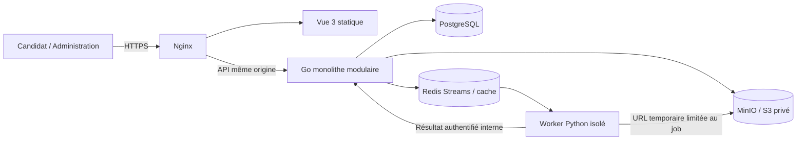
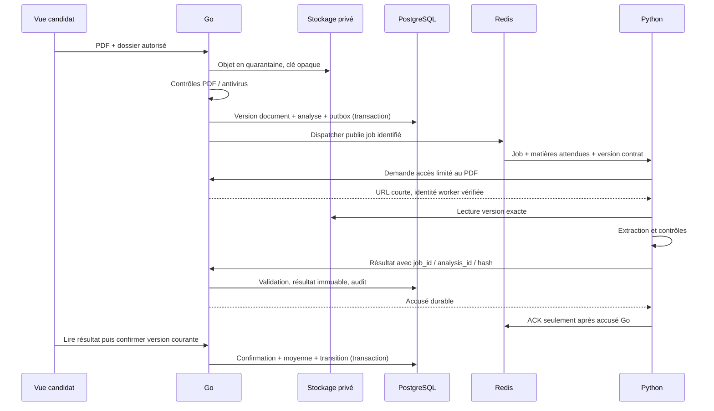

# Architecture cible

## Principe
Monolithe Go modulaire, SPA Vue et worker Python spécialisé. PostgreSQL est la source de vérité ; Redis ne conserve jamais l’unique copie d’une décision ou d’un job. La phase 0 a défini cette cible. La phase 1 fournit le bootstrap validé. La phase 2 ajoute uniquement les référentiels d’admission et leur API de lecture ; aucun candidat, document ou OCR métier. Les flux métier ci-dessous restent la cible future et ne sont pas implémentés.



## Responsabilités
| Partie | Possède | Ne décide pas |
|---|---|---|
| Vue | Formulaires, navigation, affichage extraction en lecture seule, progression, PDF, filtres | Droits, admissibilité, moyenne officielle, transitions |
| Go | Authentification, RBAC, campagnes, règles, dossiers, documents, orchestration OCR, validation résultats, moyenne, audit et classement | Moteur OCR |
| Python | Classification par page, extraction native/OCR, normalisation, correspondance, provenance et confiance | Écritures métier directes, règles d’admission, classement |
| PostgreSQL | État durable, versions, jobs/outbox, contraintes, historique | Contenu binaire PDF |
| S3/MinIO | Objets privés immuables et dérivés à accès limité | Autorisation métier |
| Redis | Transport de jobs, cache et rate limiting selon usage | Vérité métier ou archivage |

Go : modules `identity`, `campaigns`, `admissions`, `documents`, `analysis`, `review`, `ranking`, `audit`. À l’intérieur : domaine, cas d’usage, ports et adaptateurs quand nécessaires. Pas d’accès aux tables d’un autre module depuis le transport ; orchestration par cas d’usage explicites. API HTTP JSON versionnée `/api/v1` ; OpenAPI et contrat OCR à écrire dans une phase dédiée. Erreurs structurées (code, message sûr, champs, correlation_id) ; pagination et filtres serveur. TypeScript strict, Composition API et composants SFC ; état partagé limité dans Pinia, données serveur chargées par services/composables.

## Flux documentaire et fiabilité


Décision proposée : Redis Streams avec groupes de consommateurs ; outbox PostgreSQL et dispatcher dans le processus Go (pas un microservice). Livraison au moins une fois ; idempotence obligatoire. Job porte identifiants opaques, révision dossier/document, hash, version de grille et matières canoniques attendues, jamais des coefficients configurés ni identité complète.
Python appelle un endpoint interne Go authentifié par identité de service à permissions limitées. Pas d’accès PostgreSQL depuis le worker. Go vérifie contrat, bornes, identifiants, provenance et fraîcheur avant activation ; un résultat tardif reste historique et ne remplace pas l’analyse courante. Acquittement durable, récupération des jobs abandonnés, reprises plafonnées avec backoff, délai maximal et file d’échecs ; Go conserve chaque tentative et rapproche périodiquement les jobs durables de la queue. En cas de callback perdu, renvoi idempotent du résultat avant ACK. Les seuils opérationnels restent à fixer.
Front : polling initial sur analyse/dossier, fréquence bornée et arrêt une fois terminal ; SSE seulement si besoin démontré. Le navigateur ne communique pas directement avec Redis/Python.

## Stockage, cohérence et calcul
Upload initial via Go en streaming avec limites ; facilite autorisation et quarantaine. Évolution vers upload présigné uniquement avec finalisation serveur et contrôles identiques. Clés générées côté serveur, sans nom/email ; empreinte SHA-256, taille, type détecté, page count et version référencés en base. Aucun PDF servi avant contrôle. Les opérations S3/SQL ne sont pas atomiques : états `PENDING / QUARANTINED / ACCEPTED / REJECTED`, finalisation idempotente, nettoyage des objets orphelins et rapprochement planifié.
Prévisualisation après contrôle RBAC par Go, soit streaming protégé avec support Range, soit URL signée à durée courte ; ces URL ne vont ni dans les logs ni dans des outils tiers. Même contrôle pour vignettes et zones OCR. Buckets privés, chiffrement au repos, versionnement/rétention adaptés ; politiques de purge coordonnées avec PostgreSQL.
Notes/coefficients décimaux, jamais flottants binaires pour le classement. Comparer les ratios non arrondis par produits croisés des sommes décimales ou représentation équivalente exacte. Valeur affichée arrondie uniquement au rendu ; algorithme versionné. Confirmation, calcul, transitions et invalidation dans des transactions Go, avec version optimistic-lock et contraintes d’unicité.

## Sécurité et exploitation prévues
Production : TLS Nginx, cookies HttpOnly/Secure/SameSite, sessions opaques révocables ; CSRF et vérification Origin sur mutations ; CORS fermé par défaut. Hash de mots de passe spécialisé (Argon2id proposé, paramètres à calibrer), MFA admin, révocation et expirations. Vérification du rôle ET du périmètre campagne ET du propriétaire sur chaque requête ; audit aussi des lectures de documents.
Validation serveur des champs et fichiers ; taille/pages/pixels/temps bornés, anti-malware, PDF chiffrés/non lisibles et contenus actifs rejetés ou rendus sûrs selon politique. Worker sans privilèges, limites CPU/RAM, fichiers temporaires purgés, réseau sortant interdit sauf endpoints internes nécessaires. Parser un PDF ne constitue pas un contrôle antivirus.
Secrets injectés hors dépôt ; comptes PostgreSQL/S3/Redis à moindre privilège ; Redis/Python/PostgreSQL non exposés publiquement. Journaux techniques : identifiants de corrélation, latences, erreurs sûres ; jamais identité, texte OCR, PDF ou URL signée. Audit à accès restreint, append-only pour l’application ; protection supplémentaire contre altération au déploiement.
Compose futur : frontend, api, worker, postgres, redis, minio, nginx, profil de contrôle antivirus à choisir. Healthchecks, migrations contrôlées, volumes persistants et secrets locaux non versionnés. HTTP local éventuellement autorisé uniquement en développement, sans prétendre fournir HTTPS production.
Sauvegardes chiffrées PostgreSQL + objets et restauration cohérente testée ; RPO/RTO et conservation à confirmer. Mesures : jobs en attente/échec, âge queue, latences, taux d’extraction complète, erreurs d’autorisation. Pas de données personnelles en métriques.

## Arborescence adoptée en phase 1
```text
ifri-admissions/
├── AGENTS.md
├── README.md
├── .editorconfig
├── .gitignore
├── .env.example
├── compose.yaml
├── compose.native.yaml           # accès bases hôte optionnel
├── .github/workflows/checks.yml
├── apps/web/
│   ├── src/app/router/
│   ├── src/pages/
│   ├── src/lib/
│   ├── src/styles/
│   ├── src/App.vue
│   └── src/main.ts
├── services/api/
│   ├── cmd/api/
│   ├── internal/config/
│   ├── internal/platform/{database,httpserver,storage}/
│   ├── migrations/README.md
│   ├── go.mod
│   └── go.sum
├── services/ocr/
│   ├── src/ifri_ocr/
│   ├── tests/
│   └── pyproject.toml
├── infra/{nginx,minio,scripts}/
├── docs/
└── design-system/ifri-admissions/MASTER.md
```
Organisation `apps/web` et `services/api|ocr` demandée par l’utilisateur ; remplace la proposition phase 0 `frontend/backend/worker`. Les modules Go futurs iront dans `services/api/internal/modules/<module>` ; les fonctionnalités Vue dans `apps/web/src/features/<feature>`. Pas de fichiers placeholders pour ces modules, pas d’orchestrateur JS.

## Bootstrap local concret
- Vite sur loopback 5173, proxy `/api/health|ready` vers les endpoints Go sans préfixe ; `/api/v1/…` est préservé pour les référentiels.
- Go `net/http` sans Chi (inutile pour deux routes), pgxpool et go-redis. Écoute native loopback par API_HOST, écoute conteneur 0.0.0.0 avec publication hôte loopback. Configuration environnement validée avant l’écoute ; `slog` JSON, timeouts et shutdown gracieux.
- `/health` = liveness 200 sans dépendances. `/ready` = pgx Ping, Redis PING authentifié, HTTP MinIO `/minio/health/ready`, budget 2 s, statut 503 si indisponible. Corps sans détails sensibles. Docker health API utilise `/ready`.
- Worker Python : Redis PING initial puis heartbeat temporaire actualisé toutes les 5 s après PING réussi, périmé après 20 s ; sortie en cas d’erreur et suppression du heartbeat au shutdown. Healthcheck Docker lit ce fichier ; aucun HTTP public ni consommation de queue.
- Compose : postgres, redis, minio, api, ocr-worker et initialiseur `minio-init` ponctuel. Réseau `internal: true` partagé, plus bridge `local` pour les services avec ports publiés sur `127.0.0.1` ; PostgreSQL, Redis, worker et initialiseur uniquement sur internal par défaut ; override compose.native.yaml pour accès PostgreSQL/Redis natif au besoin. Volumes nommés. API/worker non root, filesystem en lecture seule (tmpfs pour worker), capabilities retirées.
- Bucket `ifri-documents` configurable, création idempotente et politique anonyme `none`. Initialiseur seul détenteur des credentials root ; API fait seulement un contrôle HTTP de disponibilité, sans SDK S3/credentials/upload.
- MinIO Community et mc construits depuis leurs releases source figées, leurs dépôts étant archivés ; solution locale, stratégie S3 production à revoir avant déploiement.
- Goose 3.29.0 intégré pour la phase 2, via Provider et pgx stdlib uniquement ; migrations explicites par commande db, distinctes du démarrage API.
- Nginx documenté uniquement ; authentification, TLS, RBAC, uploads et queue restent hors périmètre phase 1. HTTP loopback local n’est pas un déploiement production.
- Polices Lexend/Source Sans 3 intégrées au bundle via Fontsource, sans CDN/runtime externe. Alias `@/*` commun Vite/TypeScript ; Pinia et Router préparés, aucun store métier. Reka/shadcn-vue différés jusqu’au premier composant nécessaire.

## Versions
Versions directes exactes inscrites dans les manifests et images de phase 1 ; tableau et raisons dans DECISIONS. Go possède son go.sum. Les locks npm/uv ont été générés par les outils officiels sur l’hôte et le bootstrap a été validé ; voir BOOTSTRAP_VALIDATION. Références officielles consultées : [Vue](https://vuejs.org/guide/introduction.html), [shadcn-vue](https://www.shadcn-vue.com/docs/introduction), [Tailwind/Vite](https://tailwindcss.com/docs/installation/using-vite). Aucune compatibilité de versions non installées n’est présentée comme testée.

## Module de référentiels — phase 2

`internal/modules/references` : modèles sans valeurs scolaires → Repository pgx → Service (sélection campagne, éligibilité, cohérence) → handlers net/http. Le transport ne contient aucun SQL ; dépendances injectées explicitement, sans framework. L’API principale compose ce module avec les endpoints techniques et le middleware CORS/logs existants.

`cmd/db` gère Up/Down Goose et seed développement explicites, avec budget 60 s. Le binaire et les SQL sont embarqués dans l’image API. Le profil Compose `test` ajoute uniquement un runner Go ponctuel, sur réseau interne, utilisant PostgreSQL existant mais un schéma temporaire isolé. Ce n’est pas un service métier supplémentaire.

Matrice, version de grille, offres et quotas sont lus en PostgreSQL ; aucune matrice Go et aucune déduction depuis la série. Les tests peuvent contenir des attentes explicites indépendantes du seed. Contrat public dans ADMISSION_RULES, vérifié par tests HTTP et script references_smoke.py. Aucun store/page Vue métier ajouté.

## Parcours brouillon — phase 3

Module drafts : handlers HTTP stricts + normalisation + repository transactionnel pgx, sans SQL dans le transport. Les requêtes du module references sont réutilisables via pool ou transaction (interface Queryer), ce qui permet de vérifier les règles avant la mise à jour atomique. Verrous application/session et campagne, version optimiste et invalidation du programme après changement d’origine. Migration explicite 00003 via runner db existant.

Vue : route candidature lazy, CandidateLayout, composants natifs accessibles, client API central avec credentials et erreurs sûres, Pinia contenant uniquement état serveur et chargement, état de saisie transitoire dans la page. Pas de storage navigateur de PII/secret. Autosave sérialisé et confirmation d’étape après acquittement. Vite conserve le proxy de phase 2.

Cookie opaque court périmètre, hash PostgreSQL, durée configurable ; Origin obligatoire pour mutations JSON, CORS credentials pour origine unique. Logs de route nommée au lieu d’URL libre. Lire CANDIDATE_FLOW pour contrat et limites de la session anonyme. Aucun module documentaire ajouté.

## Phase 4 — documents

Module Go documents → autorisation drafts/référentiels → validation temporaire qpdf → port storage.Objects → adaptateur S3 → repository pgx transactionnel. SDK fournisseur confiné à platform/storage ; API sert le contenu privé, aucun accès direct public au bucket.

Upload limité et temporaire, SHA-256, stockage puis metadata ; compensation sur échec certain et conservation sur commit indéterminé. Détails et limites dans DOCUMENT_WORKFLOW. Vue utilise la couche API existante (multipart sans imposer de boundary), documents serveur et version optimiste du brouillon ; cinq étapes sans OCR/soumission.

## Phase 5 — implémentation en validation

Go analysis orchestre la file durable/Streams, autorise les lectures candidat, valide le callback et les confirmations. Le worker Python consomme le groupe Redis et extrait le PDF dans un sous-processus borné. PDF privé fourni par listener Go interne 8081 via abstraction S3 existante, sans credentials stockage exposés au worker ; callback Bearer secret interne. Listener distinct de l’API publique 8080, aucun port interne publié. Frontend ne parle qu’à /api/v1 et poll toutes les 3–10 secondes, maximum 60 lectures automatiques, arrêt terminal.

Vue ajoute étape Analyse (lecture seule, confirmation explicite, rejet avec confirmation puis remplacement), puis Vérification gouvernée par verificationReady serveur. Documents/master conservés. Les tests réels du pipeline et performances restent à exécuter ; PHASE5_VALIDATION recense les preuves.

## Phase 5.1 — correction en validation

Orchestration backend et Redis de phase 5 conservée : déclenchement déjà automatique dans transaction document/contexte. Aucun endpoint public de lancement à supprimer, aucun nouvel endpoint de mutation scolaire. Evidence JSON enrichie de métadonnées de profil/preprocessing bornées ; migration existante inchangée.

Vue : cinq étapes, analyse montée dans un slot de la carte du relevé, clé version/contexte pour invalider l’affichage précédent. API de lecture et confirmation existante ; aucune action candidate pour lancer/rejouer l’OCR. Worker : modules layouts, preprocessing et scans séparés du port Tesseract ; texte natif conservé, scans RGB à 300 DPI, variantes/PSM bornés et géométrie inverse. Corpus privé isolé des contextes de build, fixtures synthétiques publiques pour régression.

### Stratégie BAC général par cellules — correction demandée

La stratégie active pour les scans BAC général remplace les essais OCR globaux par : correction géométrique prudente (contour de page quadrilatéral crédible, puis deskew), binarisation du canal V HSV (= max RGB), ancres du premier groupe écrit et Total écrit, reconstruction morphologique d'une grille de cinq colonnes fixes, OCR PSM7 de chaque cellule agrandie ×3. Whitelist numérique `0123456789,.`. Les en-têtes OCR ne déterminent plus les colonnes. Les tables sans séparateurs horizontaux internes utilisent les bandes de texte numérique pour reconstruire les séparations ; une géométrie ou des cellules incohérentes imposent NEEDS_REVIEW. Les profils génériques conservent leur chemin existant.

La liste fermée documentaire des matières BAC sert au matching ; elle ne remplace pas le snapshot des matières d'admission. Notes et coefficients viennent toujours de leurs propres cellules. Points = note × coefficient et Sur = 20 × coefficient sont vérifiés exactement sur chaque ligne, puis les sommes coefficient/points/Sur sont comparées au Total écrit. La note récapitulative imprimée peut être arrondie ou tronquée au centième : contrôle secondaire avec tolérance `0,01 × coefficient total` ; aucun résultat de moyenne d'admission n'est créé.

Sur demande explicite de l'utilisateur, ces preuves arithmétiques remplacent le seuil Tesseract **uniquement pour ce profil**. Les confiances réelles restent présentes. Go revérifie indépendamment les produits, sommes, ligne sélectionnée et bornes de valeurs avec `big.Rat` avant acceptation d'une extraction à faible confiance. Les lignes incohérentes portent NEEDS_REVIEW dans le diagnostic ; le résultat conserve l'état terminal existant LOW_CONFIDENCE avec failureCode NEEDS_REVIEW, afin de ne pas inventer un circuit administratif de phase 6.

Diagnostic privé : texte brut des cinq cellules du tableau uniquement, valeurs parsées, contrôles par ligne, contrôles des totaux et série. Aucun en-tête d'identité, texte de page complet, hash ou PDF n'est exporté. Calibration via `ocr_private_run.py` ; l'ancien argument `--evaluate` utilise désormais la même stratégie, sans matrice de variantes. Les anciens benchmarks sont historiques et ne valident pas ce nouveau chemin. Test réel et régression Docker restent à mesurer. RapidOCR sera évalué sur les mêmes cellules seulement si la lecture numérique reste insuffisante, après vérification de compatibilité Python 3.14.
