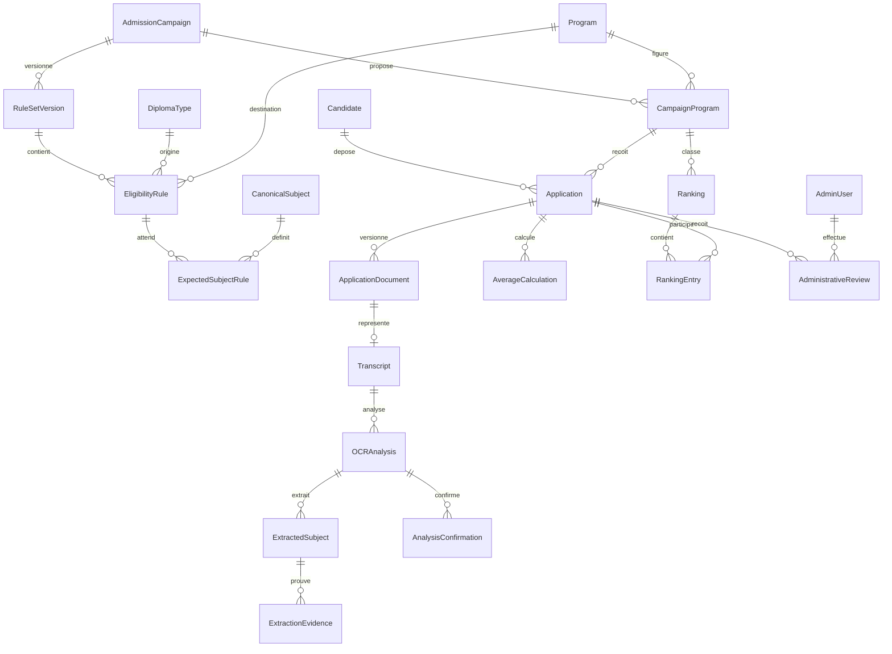

# Modèle conceptuel de données

Modèle cible, sans DDL ni migrations dans cette phase. Identifiants opaques UUID ; timestamps UTC ; montants de notes/coefficients en `NUMERIC` avec précision à fixer selon corpus. Versions immuables pour règles, documents et résultats. Références campagne explicites pour empêcher les croisements entre années.

## Entités
| Entité | Données principales et relations |
|---|---|
| AdmissionCampaign | id, nom, année, opens_at, closes_at, statut ; possède offres de filières et versions de grille |
| CampaignProgram | campagne + Program, quota non négatif, ouverture opérationnelle ; unique (campagne, filière) |
| Program | code stable, nom, actif ; cinq filières initiales |
| DiplomaType | code stable, famille BAC/DT, série/spécialité exacte (C, D, E, IMI, DWM, EAP…), actif |
| RuleSetVersion | campagne, numéro, source officielle, état DRAFT/PUBLISHED, auteur/date ; publication immuable |
| EligibilityRule | version grille, diplôme, filière, admissibilité et conditions documentées ; absence ≠ autorisation |
| CanonicalSubject | code, libellé ; alias normalisés versionnés pour correspondance OCR |
| ExpectedSubjectRule | règle d’admissibilité + matière canonique + ordre ; ensemble complet pour le couple diplôme/filière ; **aucun coefficient, aucune note** |
| Candidate | identité, email, téléphone ; références d’authentification à décider ; indépendant des campagnes |
| Application | candidat, CampaignProgram, diplôme, année obtention, snapshot identité au dépôt, règle/version utilisée, états dépôt/administration, active_analysis_id, revision, submitted_at |
| ApplicationDocument | dossier, type (DIRECTOR_REQUEST, TRANSCRIPT, IDENTITY, PARENTAL_COMMITMENT), version, clé objet privée, hash, taille/type détecté/pages, statut sécurité, superseded_at |
| Transcript | document relevé exact, application ; lie les analyses d’une même version PDF |
| OCRAnalysis | transcript, révision dossier, version grille/moteur/contrat, état, confiance globale, dates, erreurs, matières attendues figées, tentative/job |
| ExtractedSubject | analyse, matière canonique, libellé brut, note NUMERIC nullable, coefficient NUMERIC nullable, page, confiance ; valeur absente explicite, jamais zéro par défaut |
| ExtractionEvidence | extracted_subject, champ SUBJECT/GRADE/COEFFICIENT, page, bounding box, texte brut, confiance par champ, méthode native/OCR, dimensions/rotation/page coordinate system |
| AnalysisConfirmation | analyse exacte, document/hash, version grille, candidat, décision CORRECT/INCORRECT, date ; immuable |
| AverageCalculation | dossier, analyse acceptée, version algorithme, somme pondérée, somme coefficients, moyenne indicative, scale, provenance ; immuable, activation explicite |
| AdministrativeReview | dossier, reviewer/admin, décision, motif, révision examinée, date ; événements immuables |
| Ranking | campagne/filière, version, quota figé, politique départage/version, date, auteur, statut PROPOSED/APPROVED/INVALIDATED |
| RankingEntry | ranking, application, calculation_id, rang (nullable si égalité non résolue), proposition, décision NOT_DECIDED/SELECTED/WAITING_LIST/NOT_SELECTED, décideur/date |
| AdminUser | identité, email unique normalisé, hash mot de passe, rôle SUPER_ADMIN/ADMIN/REVIEWER, actif, périmètres campagnes, MFA |
| Session | principal/type candidat ou admin, hash du jeton opaque, expiration, révocation ; aucune session brute dans les logs |
| ApplicationTransition | dossier, axe, état avant/après, acteur/service, motif, version, date, correlation_id |
| AuditLog | acteur/type, action, ressource opaque, campagne, horodatage, changements minimisés, correlation_id ; accès et mutations sensibles |
| OCRJob / OutboxEvent | analyse, état durable, idempotency_key, essais, délai, événement publié ; fiabilité Redis, pas entité d’admission |

`ExtractedSubject.page` désigne la page de la ligne ; les preuves de chacun des trois champs sont distinctes. S’il existe plusieurs candidats à une extraction, conserver les alternatives dans un payload versionné sans fabriquer une valeur acceptée. La relation active_analysis doit appartenir au même dossier ; même exigence pour confirmation et calcul.

## Relations structurantes

## Contraintes et historique
- Quota par campagne/filière, jamais sur Program global. Année non nécessairement unique : plusieurs campagnes possibles.
- Hypothèse : un dossier et une filière par candidat/campagne ; contrainte unique à confirmer avant migration. Email n’est pas une preuve d’identité ni une clé métier de dédoublonnage.
- Chaque version document unique (dossier, type, version) ; une seule version courante acceptée par type. Même PDF peut recevoir plusieurs analyses moteur, jamais écrasées.
- Chaque sujet attendu doit avoir une extraction acceptée unique dans l’analyse active ; doublons/absences bloquent l’acceptation. Note valide selon échelle, coefficient > 0 ; NULL représente l’inconnu. Aucun coefficient dans ExpectedSubjectRule, EligibilityRule ou CampaignProgram.
- Contraintes FK/uniques/checks en base complétées par transactions Go pour invariants entre tables. Vérifier cohérence campagne/programme/règle/diplôme. Index futurs sur campagne, filière, diplôme, statuts, moyenne et références jobs ; pagination sans fuite intercampagne.
- Changement d’origine/filière/PDF : nouvelle révision et nouvelles références ; anciennes preuves restent historiques, confirmation et moyenne ne sont plus actives. Dossier rouvert = exclusion du classement courant et invalidation de la proposition concernée.
- Calcul garde ses opérandes ; classement garde son périmètre et ses calculs sources. Publication exige un dernier contrôle transactionnel de fraîcheur des dossiers et quotas.
- Conservation, effacement, anonymisation et exceptions d’audit restent à fixer. Pas de suppression en cascade des preuves d’une décision sans politique validée ; historique ne signifie pas conservation illimitée.
