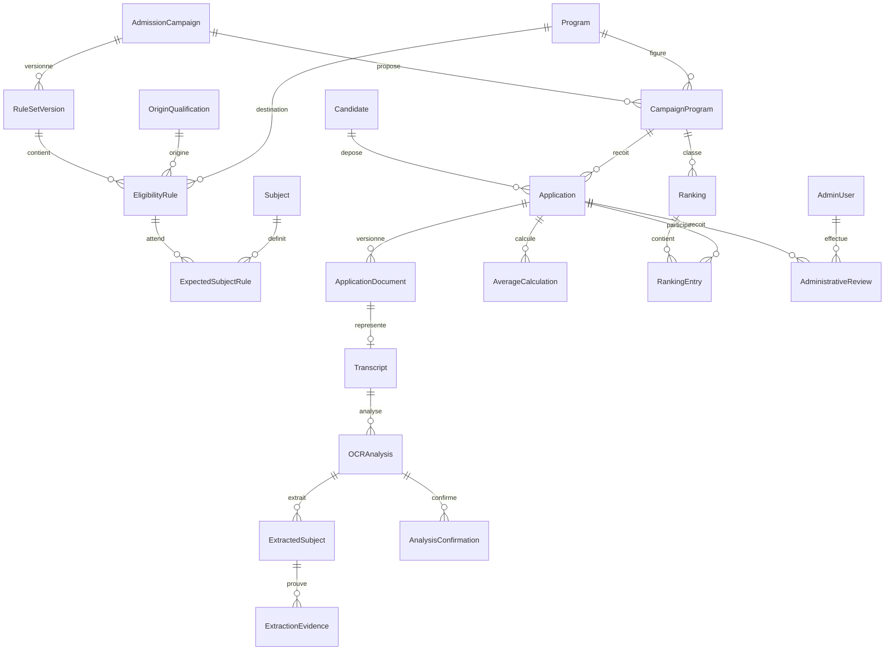
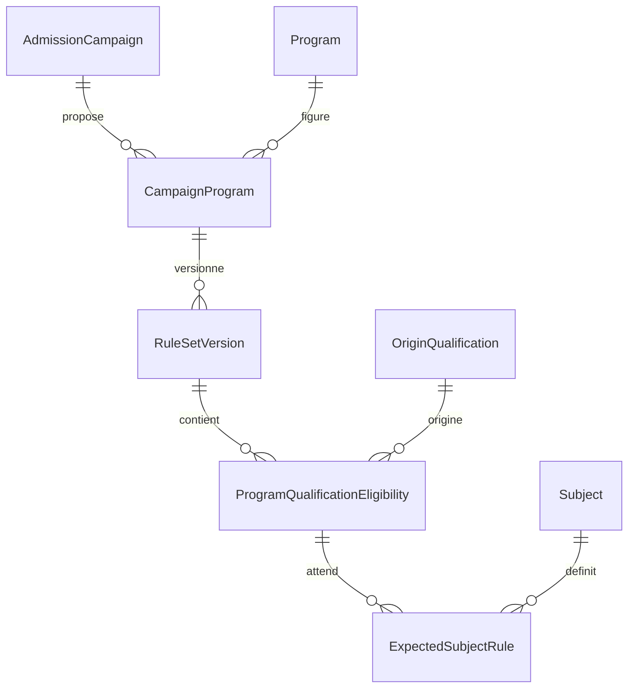

# Modèle conceptuel de données

Modèle cible, complété par les schémas concrets des phases 2 à 5 ci-dessous. Identifiants opaques UUID ; timestamps UTC ; montants de notes/coefficients en `NUMERIC` avec précision à fixer selon corpus. Versions immuables pour règles, documents et résultats. Références campagne explicites pour empêcher les croisements entre années.

## Entités
| Entité | Données principales et relations |
|---|---|
| AdmissionCampaign | id, nom, année, opens_at, closes_at, statut ; possède offres de filières et versions de grille |
| CampaignProgram | campagne + Program, quota non négatif, ouverture opérationnelle ; unique (campagne, filière) |
| Program | code stable, nom, actif ; cinq filières initiales |
| OriginQualification | code stable, famille BAC/DT, série/spécialité exacte (C, D, E, IMI, DWM, EAP…), actif |
| RuleSetVersion | campagne, numéro, source officielle, état DRAFT/PUBLISHED, auteur/date ; publication immuable |
| EligibilityRule | version grille, diplôme, filière, admissibilité et conditions documentées ; absence ≠ autorisation |
| Subject | code, libellé ; alias normalisés versionnés pour correspondance OCR |
| ExpectedSubjectRule | règle d’admissibilité + matière canonique + ordre ; ensemble complet pour le couple diplôme/filière ; **aucun coefficient, aucune note** |
| Candidate | identité, email, téléphone ; références d’authentification à décider ; indépendant des campagnes |
| Application | candidat, CampaignProgram, diplôme, année obtention, snapshot identité au dépôt, règle/version utilisée, états dépôt/administration, active_analysis_id, revision, submitted_at |
| ApplicationDocument | dossier, type (DIRECTOR_REQUEST, TRANSCRIPT, IDENTITY, PARENTAL_COMMITMENT), version, clé objet privée, hash, taille/type détecté/pages, statut sécurité, superseded_at |
| Transcript | document relevé exact, application ; lie les analyses d’une même version PDF |
| OCRAnalysis | transcript, révision dossier, version grille/moteur/contrat, état, confiance globale, dates, erreurs, matières attendues figées, tentative/job |
| ExtractedSubject | analyse, matière canonique, libellé brut, note NUMERIC nullable, coefficient NUMERIC nullable, page, confiance ; valeur absente explicite, jamais zéro par défaut |
| ExtractionEvidence | extracted_subject, champ SUBJECT/GRADE/COEFFICIENT, page, bounding box, texte brut, confiance par champ, méthode native/OCR, dimensions/rotation/page coordinate system |
| AnalysisConfirmation | analyse exacte, document/hash, version grille, candidat, décision CORRECT/INCORRECT, date ; immuable |
| AverageCalculation | dossier, analyse acceptée, version algorithme, somme pondérée, somme coefficients, moyenne indicative, scale, provenance ; immuable, activation explicite |
| AdministrativeReview | dossier, reviewer/admin, décision, motif, révision examinée, date ; événements immuables |
| Ranking | campagne/filière, version, quota figé, politique départage/version, date, auteur, statut PROPOSED/APPROVED/INVALIDATED |
| RankingEntry | ranking, application, calculation_id, rang (nullable si égalité non résolue), proposition, décision NOT_DECIDED/SELECTED/WAITING_LIST/NOT_SELECTED, décideur/date |
| AdminUser | identité, email unique normalisé, hash mot de passe, rôle SUPER_ADMIN/ADMIN/REVIEWER, actif, périmètres campagnes, MFA |
| Session | principal/type candidat ou admin, hash du jeton opaque, expiration, révocation ; aucune session brute dans les logs |
| ApplicationTransition | dossier, axe, état avant/après, acteur/service, motif, version, date, correlation_id |
| AuditLog | acteur/type, action, ressource opaque, campagne, horodatage, changements minimisés, correlation_id ; accès et mutations sensibles |
| OCRJob / OutboxEvent | analyse, état durable, idempotency_key, essais, délai, événement publié ; fiabilité Redis, pas entité d’admission |

`ExtractedSubject.page` désigne la page de la ligne ; les preuves de chacun des trois champs sont distinctes. S’il existe plusieurs candidats à une extraction, conserver les alternatives dans un payload versionné sans fabriquer une valeur acceptée. La relation active_analysis doit appartenir au même dossier ; même exigence pour confirmation et calcul.

## Relations structurantes

## Contraintes et historique
- Quota par campagne/filière, jamais sur Program global. Année non nécessairement unique : plusieurs campagnes possibles.
- Hypothèse : un dossier et une filière par candidat/campagne ; contrainte unique à confirmer avant migration. Email n’est pas une preuve d’identité ni une clé métier de dédoublonnage.
- Chaque version document unique (dossier, type, version) ; une seule version courante acceptée par type. Même PDF peut recevoir plusieurs analyses moteur, jamais écrasées.
- Chaque sujet attendu doit avoir une extraction acceptée unique dans l’analyse active ; doublons/absences bloquent l’acceptation. Note valide selon échelle, coefficient > 0 ; NULL représente l’inconnu. Aucun coefficient dans ExpectedSubjectRule, EligibilityRule ou CampaignProgram.
- Contraintes FK/uniques/checks en base complétées par transactions Go pour invariants entre tables. Vérifier cohérence campagne/programme/règle/diplôme. Index futurs sur campagne, filière, diplôme, statuts, moyenne et références jobs ; pagination sans fuite intercampagne.
- Changement d’origine/filière/PDF : nouvelle révision et nouvelles références ; anciennes preuves restent historiques, confirmation et moyenne ne sont plus actives. Dossier rouvert = exclusion du classement courant et invalidation de la proposition concernée.
- Calcul garde ses opérandes ; classement garde son périmètre et ses calculs sources. Publication exige un dernier contrôle transactionnel de fraîcheur des dossiers et quotas.
- Conservation, effacement, anonymisation et exceptions d’audit restent à fixer. Pas de suppression en cascade des preuves d’une décision sans politique validée ; historique ne signifie pas conservation illimitée.

## Schéma effectivement ajouté en phase 2

- `admission_campaigns` : UUID v4, code unique, name, academic_year, starts_at/ends_at timestamptz, statut CHECK DRAFT/OPEN/CLOSED/ARCHIVED, created_at/updated_at. Fermeture strictement après ouverture ; année non unique.
- `programs` : UUID, code unique, name, enabled et timestamps.
- `origin_qualifications` : UUID, code unique, label, family CHECK BAC/DT, enabled. Remplace le nom conceptuel DiplomaType sans décomposer artificiellement diplôme/série/spécialité.
- `subjects` : UUID, code unique, name, enabled. Nom concret de CanonicalSubject, sans valeurs scolaires.
- `campaign_programs` : UUID, FK campagne/filière, unique couple, enabled, available_seats entier nullable CHECK >=0.
- `rule_set_versions` : UUID, FK CampaignProgram, version >0 unique par offre, source, statut DRAFT/PUBLISHED, created_at. Granularité de versionnement par offre campagne/filière (précision du modèle initial par campagne) ; index partiel unique : une grille publiée par offre.
- `program_qualification_eligibilities` : UUID, FK version/qualification, eligible, unique (version, qualification). Aucune duplication de campagne/programme dans cette table. Les qualifications peuvent varier entre versions, jamais être dupliquées dans une version.
- `expected_subject_rules` : UUID, FK éligibilité/matière, position >0, unique (éligibilité, matière) et (éligibilité, position). **Aucune note, aucun coefficient, aucun poids.**

FK restrictives sans cascade de données métier. Les index PK/uniques servent aux recherches par code et à la traversée campagne → offre → grille → qualification → matières ; aucun index métier spéculatif.

Triggers : seules les grilles DRAFT sont modifiables ; publication exige au moins une combinaison éligible, des matières non vides et positions contiguës à partir de 1, aucun sujet sur une combinaison explicitement refusée. Publication directe à l’insertion interdite. Éligibilités et sujets d’une grille publiée immuables, y compris changement de parent ; verrou du parent pour coordonner écriture/publication. Le service refuse aussi les grilles incomplètes ou sujets désactivés. Mise à jour automatique des timestamps à introduire avec les futurs cas d’écriture, absents de cette API de lecture.

Toutes les autres entités restent conceptuelles et ne possèdent aucune table ni endpoint dans cette phase.

## Schéma ajouté en phase 3

Migration 00003, migrations 00001/00002 inchangées. `candidates` : UUID, last_name/first_names/email/phone, created_at/updated_at ; chaînes vides autorisées pour brouillon incomplet, longueurs bornées, email trim/lower, téléphone vide ou syntaxe internationale. Email non unique : la possession d’un email ne donne pas un droit d’accès, aucune fusion automatique de personnes.

`applications` : UUID, candidate_id, campaign_id, campaign_program_id nullable, origin_qualification_id nullable, graduation_year nullable, state CHECK DRAFT/SUBMITTED/CANCELLED (seul DRAFT utilisable via API), version positive, timestamps. Unique candidat/campagne ; FK composite offre/campagne interdit croisements d’années ; filière nécessite qualification ; année CHECK 1900–9999, borne année courante validée en Go. Index campagne et index unique candidat/campagne ; aucun numéro officiel.

`application_draft_sessions` : UUID, application_id, secret_hash bytea 32 octets unique, expires_at, revoked_at nullable, created_at ; expiration après création, index application pour révocation future. Aucun secret brut en base. Autorisation par session, pas par application UUID. Profil, qualification et filière modifiables uniquement pour DRAFT/campagne ouverte dans des transactions verrouillant application/session ; contrôle de concurrence par version. Enregistrement de notes/document/OCR hors périmètre.

## Phase 4 — documents privés versionnés

Migration 00004_application_documents.sql : application_documents (UUID, application_id, document_type, current_version_id, timestamps) et document_versions (UUID, application_document_id, version_number, storage_key, original_filename, content_type, size_bytes, sha256, created_at, replaced_at).

Unique candidature/type, numéro positif unique par document, clé unique, taille positive, PDF MIME uniquement, SHA-256 hex64. Index partiel : une version non remplacée par document. FK composite différée + triggers différés : version courante existante, du même document, non remplacée. L’historique reste privé. Future analyse liée à document_version_id, aucune analyse ajoutée. Voir DOCUMENT_WORKFLOW.

## Phase 5 — schéma exécuté et validé

00005_ocr_analyses.sql ajoute ocr_analyses (application, document_version exact, grille, programme, qualification, snapshot expected_subjects, statut OCR, confirmation séparée, tentative, moteur/version, timestamps, digest résultat et dispatch) et ocr_extracted_subjects (matière/position, raw/value NUMERIC, page, confiance par champ, evidence JSON). Aucun coefficient dans le snapshot des matières attendues.

Index unique de contexte non obsolète ; matières/positions uniques par analyse. Triggers transactionnels sur choix académique et version courante TRANSCRIPT : invalidation OBSOLETE puis nouvelle analyse si contexte éligible. Un contexte revisité crée une nouvelle analyse ; une analyse rejetée reste bloquée sur la même version. Anciennes analyses et confirmations conservées. Note 0..20, coefficient positif, confiance 0..1. Aucun calcul/numéro officiel ajouté.

La migration 00005 ajoute aussi ocr_analysis_attempts : clé (analysis_id, tentative), digest du callback, statut technique rapporté, code d’échec, moteur/version, date. Les tentatives techniques restent auditables sans texte complet. contract_version=1 sur analyse ; trigger de propriété vérifie que le relevé appartient au dossier et que la grille/programme/qualification appartiennent à sa campagne.

Phase 5.1 : evidence JSON enrichie de profile, section, preprocessing, dpi, psm et deskewDegrees optionnels validés par Go. Bbox toujours dans la page source normalisée, après inversion crop/deskew. Aucun changement de table ni migration 00005 ; anciennes preuves restent lisibles et immuables. Refresh et lecture frontend ne créent aucune ligne d’analyse.

### Correction documentaire : notes dérivées exclusivement après trois totaux

Instruction utilisateur prioritaire : quand Σ Coeff, Σ Points et Σ Sur lus correspondent tous aux cellules Total, la valeur retenue de chaque note est Points ÷ Coeff, avec `gradeStatus=VALIDATED_BY_TOTALS` et `gradeSource=POINTS_TOTALS`. La lecture brute/directe et sa divergence restent conservées. Coeff n'est jamais dérivé. Une somme fausse ou incomplète garde toutes les lignes en NEEDS_REVIEW. Les décimales non terminantes ne sont ni arrondies ni inventées. Go autorise une divergence note brute/valeur retenue uniquement pour ce mode avec preuve complète indépendante en rationnels exacts et coordonnées Points/Sur ; les autres extractions gardent l'égalité lecture brute/valeur. Aucun calcul de moyenne d'admission n'est introduit.

Parseur : virgule décimale et séparateur final isolé acceptés (`18.`, `80 .`), sans assembler des chiffres séparés. Le contrôle Sur/Coeff ne dépend plus de la lisibilité de Note. Les noyaux morphologiques longs suppriment les traits sur chaque cellule avant agrandissement ; les crops de données ont une marge symétrique autour de leur propre bande, y compris Anglais, sans remonter à l'en-tête. Seuils de confiance inchangés.

Dernier run privé : 40,398 s, NEEDS_REVIEW, 8 rangées correctement isolées ; les notes et totaux restent insuffisants. La nouvelle correction attend son run OCR réel. Validation locale avant relance : 74 tests Python et Go tests PASS ; aucune précision réelle déclarée acquise.

## Phase 6 — soumission, numéro et snapshot (migration 00006)

Migration `00006_application_submissions.sql` ; les migrations 00001–00005 sont inchangées. Contrat et transaction : SUBMISSION_WORKFLOW ; décisions : ADR 083–094.

- **`admission_campaigns.numbering_year`** (`smallint NOT NULL`, 2000–9999) : année des numéros de la campagne, remplie pour les campagnes existantes à partir de `starts_at` en heure de Porto-Novo.
- **`applications`** :
  - `application_number` (UNIQUE, format `^IFRI-[0-9]{4}-[A-Z][A-Z0-9_]{0,63}-[0-9]{6}$`) et `submitted_at` ;
  - CHECK `DRAFT` ⇒ ni numéro ni date, `SUBMITTED` ⇒ numéro et date ;
  - contrainte différée `SUBMITTED` ⇒ snapshot complet et cohérent ;
  - trigger : une ligne non `DRAFT` refuse toute modification ou suppression, ainsi que son candidat, ses documents et ses versions de document.
- **`application_number_counters`** (`numbering_year`, `program_id`) → `last_serial` (1–999 999), modifiable seulement par incrément de 1.
- **`application_submissions`** (une par application) :
  - contexte : campagne, offre, programme, qualification, année d'obtention ;
  - identité copiée : nom, prénoms, email, téléphone ;
  - références : grille, analyse (unique), version et SHA-256 du relevé ;
  - calcul : `weighted_sum` et `coefficient_sum` exactes, `average numeric(32,30)` tronquée, `average_is_exact`, `calculation_version` ;
  - `validation_path` ;
  - index par campagne sur l'email, le téléphone et le SHA-256 du relevé.
- **`application_submission_subjects`** : par matière, référence vers la ligne extraite (unique), code et libellé, position, valeurs brutes et retenues, `validation_method` (`DIRECT_READ`, `ROW_ARITHMETIC`, `TABLE_TOTALS`), `reconstructed_cells` (`points`, `scale`).
- **`application_submission_documents`** : type, version de document (unique) et SHA-256 des quatre pièces soumises.
- **`application_submission_flags`** : code (`DUPLICATE_EMAIL`, `DUPLICATE_PHONE`, `DUPLICATE_TRANSCRIPT`, `SERIES_UNREADABLE`) et `related_application_id`, obligatoire pour un doublon ; unicité `NULLS NOT DISTINCT`.
- **`audit_events`** : `event_type`, `actor_type` (CANDIDATE, ADMIN, SYSTEM), `actor_id` nullable, `target_type` et `target_id`, `metadata` JSON objet, `occurred_at`.

Immuabilité (triggers) :
- tables de snapshot, drapeaux et audit : UPDATE, DELETE et TRUNCATE refusés ;
- analyse référencée par une soumission : aucune modification ;
- `ocr_extracted_subjects` : insertion refusée après le résultat ou la décision du candidat, TRUNCATE refusé ;
- copies vérifiées à l'insertion : une matière doit être identique à la ligne extraite, un document doit être la version courante.

`refresh_transcript_analysis` s'arrête désormais hors `DRAFT` ; le reste de la fonction est identique. Le down refuse s'il existe des soumissions, des compteurs, des événements d'audit ou une application non `DRAFT`, puis restaure la fonction de la phase 5.

Statuts administratifs futurs (phase 8) : table séparée et historisée, jamais une colonne modifiable d'`applications` (ADR 088).
