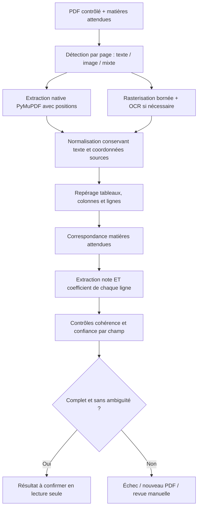

# Pipeline documentaire prévu

Les sections initiales décrivent le contrat cible. La section phase 5 précise le pipeline implémenté et ses limites, avec validation réelle encore en cours.

## Entrée et précondition
Go autorise le dossier, contrôle le PDF et résout d’abord la matrice **campagne/version + diplôme/série + filière**. Le job contient les matières attendues, leurs codes et alias versionnés ; aucun coefficient théorique. Grille absente/incomplète : pas de job de classement, erreur métier explicite.
Entrée : job_id, analysis_id, révision dossier, document_id/version/hash, version contrat et grille, liste des matières canoniques, accès temporaire obtenu par canal interne. Pas d’identité candidat inutile.

## Étapes
1. PDF texte, scanné ou mixte évalué **page par page**. Texte natif inutilisable malgré sa présence : fallback OCR ciblé. PDF chiffré, corrompu ou hors limites : motif sûr et action candidat.
2. PyMuPDF pour texte/blocs/positions et rendu. Tester PaddleOCR et Tesseract sur le corpus IFRI ; choix différé. OpenCV uniquement si deskew/débruitage/segmentation améliore réellement les résultats.
3. Normaliser accents, espaces, casse, ponctuation et décimales françaises en conservant brut et correspondance des positions. Éviter de transformer automatiquement `O` en `0` sans contexte numérique fiable.
4. Identifier colonnes (note, coefficient, autres totaux), regroupement des lignes et pages ; ne pas confondre « note × coefficient » et note, ni rang et coefficient.
5. Correspondance exacte/alias puis fuzzy matching explicable. Plusieurs lignes plausibles, alias collisionnels ou deux matières distinctes : ambiguïté conservée, pas de premier résultat silencieux.
6. Extraire pour **chaque matière attendue** libellé, note et coefficient depuis les zones de la ligne. Ne jamais compléter un coefficient absent avec une table, une autre candidature ou une estimation.
7. Contrôler numérique, échelle, coefficient positif, couverture complète, doublons et cohérence des colonnes ; somme > 0. Les bornes admissibles de coefficients ne sont pas des coefficients prédéfinis et restent à déterminer.
8. Confiance par libellé/note/coefficient et synthèse globale ; score OCR brut ≠ probabilité calibrée. Seuils et méthode de calibration issus d’un corpus annoté ; ne pas inventer « 90 % = fiable ».
9. Go valide et persiste le résultat, puis expose les données au candidat ; Python ne calcule pas la moyenne officielle.

## Sortie et preuve
Contrat cible versionné : identifiants entrée, statut COMPLETE/PARTIAL/FAILED, version moteur, matières attendues, extractions, alternatives, erreurs structurées, durées, confiance. Ces statuts techniques sont mappés par Go vers les états produit ; COMPLETE ne vaut pas confirmation.
Chaque extraction : canonical_subject_id, raw_label, grade nullable, coefficient nullable, page, confiance ; preuve par champ : texte brut, page, bbox `[x0,y0,x1,y1]`, méthode et confiance. Convention proposée : pages indexées à partir de 1 ; bbox normalisée 0..1 dans la page affichée après rotation, origine haut-gauche. Conserver dimensions, rotation et transformation depuis coordonnées natives/pixels pour retrouver précisément la zone. Contrat à tester par overlays sur PDF synthétiques.
Résultat immuable, lié au hash PDF, révision dossier, version grille et moteur. Aucune URL signée persistée. Texte brut et crops éventuels privés soumis à la même conservation que le relevé.

## Échecs, reprises et revue humaine
Distinguer erreurs techniques (timeout, worker interrompu, accès temporaire expiré) et erreurs documentaires (matière/coefficient absent, ambiguïté, illisibilité). Reprises techniques bornées sur le même document ; refus candidat = nouveau PDF. Le nombre de dépôts refusés et les tentatives techniques sont des compteurs distincts.
Résultats tardifs ou dupliqués : validation idempotente, jamais activation d’une version périmée. Quarantaine et isolation précèdent toute extraction. Logs sans texte scolaire ni identité.
Après plusieurs échecs : MANUAL_REVIEW selon politique future. L’administrateur pourra comparer chaque champ à sa zone PDF. Toute transcription manuelle éventuelle est une version distincte avec auteur, motif et preuve ; elle ne crée jamais de coefficient métier. Son autorisation et le retour à confirmation candidat doivent être décidés avant implémentation ; pas de contournement automatique du parcours.

## Évaluation avant choix moteur
Corpus autorisé, anonymisé ou synthétique : BAC C/D/E, DT IMI/DWM/EAP, PDFs texte/scannés/mixtes, rotations, faible résolution, virgules décimales, tableaux multipages, libellés proches, doublons, absence de coefficients et fichiers malveillants contrôlés.
Mesurer exactitude note et coefficient par champ, correspondance matière, taux d’extractions complètes sans erreur, faux résultats acceptés, taux de revue manuelle, latence, RAM/CPU. Séparer corpus de réglage et de validation. Revue des licences PyMuPDF et moteurs avant distribution. Aucune promesse de performance avant benchmark.

## Implémentation historique phase 5 — validée sur fixtures synthétiques

Le pipeline hybride de phase 5 a été validé sur fixtures synthétiques uniquement ; ses mesures sont dans OCR_BENCHMARK. Le chemin actif est modifié par la phase 5.1 ci-dessous. Python 3.14 conservé, PyMuPDF 1.28.2 et RapidFuzz 3.14.6 déclarés ; Tesseract système fra+eng dans l’image Docker. Extraction native des mots avec positions, coordonnées transformées selon la rotation de page ; fallback rasterisation grayscale 200 DPI lorsque texte/en-têtes inutilisables. Limites : OCR_MAX_PAGES (10 local), 25 millions de pixels par page, OCR_PAGE_TIMEOUT_SECONDS (30 local) et OCR_ANALYSIS_TIMEOUT_SECONDS (120 local).

Moteur OCR derrière OcrEngine ; Tesseract TSV fournit mots/bbox/confiance. Aucun filtre OpenCV non mesuré. Les lignes sont reconstruites par proximité verticale ; en-têtes Matière/Note/Coef localisent les bandes horizontales. Chaque cellule numérique doit contenir exactement une valeur. Doublons ou valeurs concurrentes → AMBIGUOUS_ROW, jamais choix arbitraire. Matching RapidFuzz limité à expectedSubjects du job, normalisation NFKD/casse/ponctuation ; ambiguïté entre matières si les deux scores atteignent OCR_MIN_CONFIDENCE et leur marge est <0,08. Une matière sous le seuil ne constitue pas un concurrent valide. Pas de table de coefficients ni valeur manquante inventée.

Decimal Python, chaînes numériques au contrat, big.Rat Go pour validation exacte, NUMERIC PostgreSQL. Note 0..20 et coefficient >0 ; comma/dot conservés dans raw et normalisés dans value. Provenance par champ : bbox normalisée 0..1, origine haut-gauche de la page affichée, page à partir de 1, preuves textuelles minimisées. Pas de texte complet stocké ou journalisé.

Confiance heuristique = minimum(score fuzzy, confiance OCR des mots du libellé, confiance des cellules numériques), avec préconditions fortes de colonne/couverture/nombres valides. Native utilise confiance instrumentale 1 pour les tokens, qui n’est pas une probabilité d’exactitude. OCR_MIN_CONFIDENCE centralisé à 0,85 pour les essais synthétiques, sans calibration officielle. Toutes les matières doivent être complètes et suffisamment fiables pour SUCCEEDED ; échecs/LOW_CONFIDENCE ne permettent aucune confirmation.

Redis Streams ifri:ocr:jobs:v1, groupe ifri-ocr-v1, livraison au moins une fois. Analyse QUEUED durable crée l’outbox dans PostgreSQL ; dispatcher Go publie puis marque dispatched_at dans une transaction. XADD avant échec DB peut dupliquer un message, intentionnellement. Claim interne garde une tentative ; callback lié à la tentative et validé avant transaction. Résultat terminal hashé, callback identique idempotent, différent refusé. ACK après accusé Go uniquement ; XAUTOCLAIM reprend les messages abandonnés après cinq minutes. Reprises techniques OCR_ENGINE_ERROR/ANALYSIS_TIMEOUT limitées à trois tentatives ; échecs de lecture/matching ne sont pas retentés. Les états PROCESSING abandonnés sont remis en queue ou FAILED au plafond.

Accès PDF via endpoint Go interne authentifié, lu depuis le port S3 existant : le worker ne possède aucun credential root/S3 ni accès PostgreSQL. SHA-256 du contenu doit correspondre au hash du job. Listener interne 8081 non publié dans Compose, secret aléatoire distinct, jamais frontend/logs. Upload ou choix académique crée/invalide l’analyse dans une transaction DB ; résultat tardif conservé avec statut OBSOLETE, jamais courant.

Confirmation PENDING/CONFIRMED/REJECTED séparée du statut OCR. Refus exige une nouvelle DocumentVersion ; aucun endpoint d’édition des valeurs. verificationReady est calculé côté Go sur analyse/contexte/document courants, confirmation et documents requis. Aucune moyenne ni soumission.

Une validation sur un corpus anonymisé de relevés réels représentant les différents formats BAC/DT est nécessaire avant mise en production.

Le contrat job/callback porte contractVersion=1. ocr_analysis_attempts mémorise chaque callback accepté (tentative, statut rapporté, code sûr, moteur, digest), y compris les erreurs techniques retentées ; un duplicata identique est reconnu sans modification. Le rejet d’une version de PDF bloque également toute tentative de contournement par changement puis retour de filière/qualification : TRANSCRIPT_REPLACEMENT_REQUIRED, nouvelle version obligatoire. Les lignes TSV du moteur sont utilisées lorsqu’elles sont disponibles ; sinon regroupement spatial. Les colonnes après Coef (Points/totaux) délimitent sa bande pour éviter leur confusion.

L’arrêt du worker coupe le sous-processus pendant l’analyse et conserve le message non acquitté pour reprise. Compose donne 35 secondes de grâce, afin de laisser finir les appels internes bornés à 30 secondes. Le heartbeat vérifie Redis et l’API interne (PostgreSQL/Redis/S3), indépendamment du succès d’un PDF.

## Phase 5.1 — pipeline en vigueur (clôture du 14 octobre 2026)

Cette section remplace les notes successives de calibration 5.1 ; décisions détaillées : ADR 060–082 de DECISIONS.md.

### Aiguillage et moteurs

Extraction native PyMuPDF prioritaire quand la page a mots et en-têtes exploitables. Sinon rendu 300 DPI, `prepare` (correction d'un bord de page quadrilatéral crédible, ou rotation par l'angle du bord de page quasi rectangulaire, sinon deskew par traits longs ; perspective forte refusée) puis, si le moteur est Tesseract, profil BAC par cellules ; une page qui n'est pas un BAC général retombe sur le chemin scan générique historique (multi-passes, inchangé).

Moteur de production (`ifri_ocr.engines.production_engine`) : Tesseract pour les ancres, les libellés, la lettre de série et le chemin générique ; **RapidOCR 3.10.0 (onnxruntime 1.31.0, modèle de reconnaissance PP-OCRv6 small seul) pour les cellules numériques du profil BAC**, derrière le port `CellReader`. `OCR_RAPIDOCR_ENABLED=true` (défaut) ; `false` repasse les chiffres sur Tesseract dans la même image. Le modèle est téléchargé au build, vérifié contre `services/ocr/rapidocr-models.sha256` et seul dans `/opt/rapidocr-models` ; aucun téléchargement à l'exécution (réseau interne sans sortie). `ORT_DISABLE_TELEMETRY=1` coupe la télémétrie 1DS embarquée dans les roues Linux d'onnxruntime 1.31. Readiness du worker : manifeste et SHA-256 du modèle, puis une reconnaissance d'essai ; tout échec rend le worker indisponible avec un motif statique. Le chargement du modèle (≈ 3 s par sous-processus d'analyse) se fait en tâche de fond pendant la passe d'ancrage. Provenance d'un résultat accepté par cellules : `engine=tesseract+rapidocr`, versions des deux moteurs.

### Profil BENIN_BAC_GENERAL par cellules (`ifri_ocr.bac`)

1. **Ancres** : Tesseract PSM 11, modèle `fra`, sur le canal V binarisé ; section « Épreuves écrites du premier groupe » bornée avant oral/EPS/totaux de groupe. Oral et EPS ne remplacent jamais l'écrit.
2. **Géométrie** : cinq colonnes (axes détectés ou ratios du profil 0 / 0,535 / 0,645 / 0,755 / 0,89 / 1 depuis la bordure extérieure) ; rangées = bandes d'encre de la colonne Matière comptées par caractères traversants ; en-tête + N ≥ 1 matières + Total ; borne de 30 rangées (contrat Go).
3. **Lecture en deux temps**, en parallèle (`OCR_CELL_WORKERS`) dans le budget de page : (a) libellés de toutes les bandes (trois binarisations ; recadrage sur l'encre) et lettre de série ; (b) Note/Coeff/Points/Sur jusqu'à la première rangée dont le libellé lit « Total » (sinon dernière bande). Cellule numérique : fond aplati + Otsu (repli canal rouge si trop dense), règles retirées, ligne de texte isolée, puis lecteur configuré : RapidOCR (sortie filtrée aux chiffres et séparateurs, jamais corrigée) ou Tesseract `eng` liste blanche PSM 7 puis 8/13 si illisible.
4. **Rangées de tête non-données** retirées (ni libellé, ni Total, ni couple Coeff/Sur).
5. **Attribution** (`bac.assignment`) : matrice matières attendues × rangées sur le vocabulaire documentaire fermé, affectation hongroise, plancher 0,85 et écarts ≥ 0,08 (2ᵉ rangée, 2ᵉ mot), sinon `AMBIGUOUS_ROW` / `NEEDS_REVIEW`. Les libellés des autres rangées ne sont pas requis.
6. **Arithmétique** (`bac.arithmetic`, rationnels exacts), voir la règle ci-dessous ; seules les rangées des matières attendues peuvent produire une valeur, les autres ne servent qu'aux totaux.
7. **Série** (ADR 082) : grande lettre isolée dans une zone fixe en haut à gauche, sous l'en-tête institutionnel, sans le mot « Série ». Zone relative au tableau écrit (W = largeur du tableau) : x de bord gauche − 0,12 W à bord gauche + 0,30 W, y de titre de section − 0,45 W à titre − 0,03 W. Candidat = composante unique de 2 à 8 hauteurs de texte, rapport largeur/hauteur 0,45–1,3, remplissage 0,15–0,85, entière et sans glyphe comparable à moins de 0,6 hauteur (bords de page, cadres et traits ignorés). Lecture PSM 10 : deux binarisations avec liste A–G et une lecture libre doivent donner la même lettre. Lue et différente de la qualification déclarée → `SERIES_MISMATCH` sans valeurs ; absente, multiple ou discordante → non bloquante (`seriesStatus` NOT_FOUND / AMBIGUOUS / UNREADABLE).
8. **Preuves** : boîtes de cellules normalisées vers la page source, `arithmeticRows` (cellules lues, `""` si illisibles, note directe uniquement, `reconstructed` pour une cellule déduite du Total), `arithmeticRowIndex`, `totalCells`, `series`, `gradeSource`, `validation=CELL_ARITHMETIC`. Confiances OCR conservées à titre de diagnostic ; non décisives pour ce profil.

### Règle d'acceptation BAC (ADR 079–081)

Pour chaque matière attendue, sur sa rangée :

| Situation | Décision |
|---|---|
| Coefficient : sa propre cellule, entier 1..6, Sur = 20 × Coeff | Préalable ; sinon `NEEDS_REVIEW` |
| Note lue et Points = Note × Coeff | Acceptée (`VALIDATED_BY_ROW`, `DIRECT_CELL`), sans dépendre des totaux |
| Note lue et Points lus ≠ Note × Coeff | `GRADE_POINTS_MISMATCH` |
| Note illisible, Points lus, tableau vérifié par ses totaux, toutes les autres rangées confirmées par leur note lue | Note = Points ÷ Coeff (`VALIDATED_BY_TOTALS`, `POINTS_TOTALS`), décimale finie dans [0, 20] |
| Autre cas | `NEEDS_REVIEW` |

Tableau vérifié : Σ Coeff, Σ Points et Σ Sur égaux aux cellules Total ; toutes les rangées avec coefficient validé et Points ÷ Coeff décimal fini dans [0, 20] ; aucune note lisible en contradiction avec ses Points ; moyenne affichée, si lisible, égale à la **troncature** ou à l'arrondi au plus proche (demi vers le haut) à 2 décimales de Total Points ÷ Total Coeff, rien d'autre. L'exigence « toutes les autres rangées confirmées » garantit que le Total isole les Points de la rangée dérivée : deux rangées sans note lisible pourraient compenser leurs erreurs.

**Reconstruction** (ADR 080) : si exactement une cellule d'une colonne additive (Coeff, Points, Sur) est illisible et la cellule Total lisible, sa valeur = Total − somme des autres, marquée `RECONSTRUCTED_FROM_TOTAL`. Elle ne compte que confirmée par un contrôle de sa rangée dont les autres opérandes sont lus : Sur reconstruit ↔ Coeff lu, Coeff reconstruit ↔ Sur lu, Points reconstruits ↔ note lue × Coeff. Deux cellules illisibles ou plus dans une colonne : aucune reconstruction. Un coefficient reconstruit ne sert qu'aux totaux et n'est jamais retourné ; des Points reconstruits ne sont jamais la seule source d'une note (note dérivée interdite).

### Garde-fous Go

`analysis.Validate(result, expected, threshold, qualification)` revérifie indépendamment, en rationnels exacts, la règle ci-dessus : cellules bien formées, chaque reconstruction égale au Total moins les autres rangées, coefficient retourné lu et validé, note directe égale à Points ÷ Coeff sur sa rangée, ou note dérivée seulement si la cellule Note brute est illisible, les Points lus, le tableau vérifié (sommes, coefficients, quotients, notes lisibles, moyenne tronquée ou arrondie) et toutes les autres rangées confirmées. Puis série vs qualification déclarée (lettre vide acceptée) et unicité : index de rangée distincts, tables de preuve identiques entre matières, cellules de note distinctes. Un refus marque l'analyse courante `FAILED` avec `RESULT_REJECTED` (motif statique journalisé, aucun contenu), réponse 422 que le worker acquitte ; 409 pour un rappel périmé ou conflictuel, 400 pour un corps illisible, 503 pour une erreur transitoire (seul cas rejoué). L'interface affiche immédiatement l'échec et « Remplacer le relevé ».

### Codes d'échec documentaire

| Code | Statut | Sens |
|---|---|---|
| `GRADE_POINTS_MISMATCH` | LOW_CONFIDENCE | Pour une matière attendue, la note lue contredit les Points lus de sa rangée |
| `NEEDS_REVIEW` | LOW_CONFIDENCE | Coefficient non validé, note ni vérifiée par sa rangée ni dérivable des totaux, matière attendue introuvable |
| `AMBIGUOUS_ROW` | LOW_CONFIDENCE | Deux rangées plausibles pour une matière, ou rangée mieux expliquée par un autre libellé |
| `ROW_SEGMENTATION_FAILED` / `COLUMN_SEGMENTATION_FAILED` | LOW_CONFIDENCE | Grille non reconstruite |
| `SERIES_MISMATCH` | FAILED | Série lue différente de la qualification déclarée |
| `RESULT_REJECTED` | FAILED | Résultat du worker refusé par la validation Go |

### Confidentialité et calibration

`make ocr-private` évalue chaque `<nom>.pdf` + `<nom>.expected.json` de `services/ocr/tests/private-fixtures/` (ignoré Git et contextes Docker), monté en lecture seule sous un nom anonyme, avec le budget et le moteur de production (`ARGS="--numeric-engine tesseract"` pour comparer) ; résultats bruts dans un répertoire temporaire privé toujours supprimé, validation Go par `cmd/ocrvalidate`, rapport par champ (EXACT / FALSE / MISSING), exactitude des décisions par rangée attendue même quand le document échoue, et compteurs de valeurs fausses acceptées. Aucun nom, texte OCR, note, hash ni nom de fichier dans le rapport. Images de debug uniquement avec `--keep-debug`. `make ocr-engines-benchmark` mesure le benchmark synthétique avec chacun des deux lecteurs de chiffres.

Une validation sur un corpus anonymisé de relevés réels représentant les différents formats BAC/DT est nécessaire avant mise en production.
