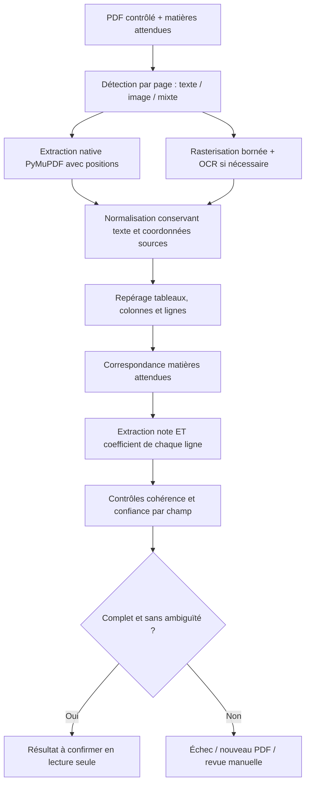

# Pipeline documentaire prévu

Ce document prépare le contrat et l’évaluation ; aucun OCR n’est développé ni installé.

## Entrée et précondition
Go autorise le dossier, contrôle le PDF et résout d’abord la matrice **campagne/version + diplôme/série + filière**. Le job contient les matières attendues, leurs codes et alias versionnés ; aucun coefficient théorique. Grille absente/incomplète : pas de job de classement, erreur métier explicite.
Entrée : job_id, analysis_id, révision dossier, document_id/version/hash, version contrat et grille, liste des matières canoniques, accès temporaire obtenu par canal interne. Pas d’identité candidat inutile.

## Étapes
1. PDF texte, scanné ou mixte évalué **page par page**. Texte natif inutilisable malgré sa présence : fallback OCR ciblé. PDF chiffré, corrompu ou hors limites : motif sûr et action candidat.
2. PyMuPDF pour texte/blocs/positions et rendu. Tester PaddleOCR et Tesseract sur le corpus IFRI ; choix différé. OpenCV uniquement si deskew/débruitage/segmentation améliore réellement les résultats.
3. Normaliser accents, espaces, casse, ponctuation et décimales françaises en conservant brut et correspondance des positions. Éviter de transformer automatiquement `O` en `0` sans contexte numérique fiable.
4. Identifier colonnes (note, coefficient, autres totaux), regroupement des lignes et pages ; ne pas confondre « note × coefficient » et note, ni rang et coefficient.
5. Correspondance exacte/alias puis fuzzy matching explicable. Plusieurs lignes plausibles, alias collisionnels ou deux matières distinctes : ambiguïté conservée, pas de premier résultat silencieux.
6. Extraire pour **chaque matière attendue** libellé, note et coefficient depuis les zones de la ligne. Ne jamais compléter un coefficient absent avec une table, une autre candidature ou une estimation.
7. Contrôler numérique, échelle, coefficient positif, couverture complète, doublons et cohérence des colonnes ; somme > 0. Les bornes admissibles de coefficients ne sont pas des coefficients prédéfinis et restent à déterminer.
8. Confiance par libellé/note/coefficient et synthèse globale ; score OCR brut ≠ probabilité calibrée. Seuils et méthode de calibration issus d’un corpus annoté ; ne pas inventer « 90 % = fiable ».
9. Go valide et persiste le résultat, puis expose les données au candidat ; Python ne calcule pas la moyenne officielle.

## Sortie et preuve
Contrat cible versionné : identifiants entrée, statut COMPLETE/PARTIAL/FAILED, version moteur, matières attendues, extractions, alternatives, erreurs structurées, durées, confiance. Ces statuts techniques sont mappés par Go vers les états produit ; COMPLETE ne vaut pas confirmation.
Chaque extraction : canonical_subject_id, raw_label, grade nullable, coefficient nullable, page, confiance ; preuve par champ : texte brut, page, bbox `[x0,y0,x1,y1]`, méthode et confiance. Convention proposée : pages indexées à partir de 1 ; bbox normalisée 0..1 dans la page affichée après rotation, origine haut-gauche. Conserver dimensions, rotation et transformation depuis coordonnées natives/pixels pour retrouver précisément la zone. Contrat à tester par overlays sur PDF synthétiques.
Résultat immuable, lié au hash PDF, révision dossier, version grille et moteur. Aucune URL signée persistée. Texte brut et crops éventuels privés soumis à la même conservation que le relevé.

## Échecs, reprises et revue humaine
Distinguer erreurs techniques (timeout, worker interrompu, accès temporaire expiré) et erreurs documentaires (matière/coefficient absent, ambiguïté, illisibilité). Reprises techniques bornées sur le même document ; refus candidat = nouveau PDF. Le nombre de dépôts refusés et les tentatives techniques sont des compteurs distincts.
Résultats tardifs ou dupliqués : validation idempotente, jamais activation d’une version périmée. Quarantaine et isolation précèdent toute extraction. Logs sans texte scolaire ni identité.
Après plusieurs échecs : MANUAL_REVIEW selon politique future. L’administrateur pourra comparer chaque champ à sa zone PDF. Toute transcription manuelle éventuelle est une version distincte avec auteur, motif et preuve ; elle ne crée jamais de coefficient métier. Son autorisation et le retour à confirmation candidat doivent être décidés avant implémentation ; pas de contournement automatique du parcours.

## Évaluation avant choix moteur
Corpus autorisé, anonymisé ou synthétique : BAC C/D/E, DT IMI/DWM/EAP, PDFs texte/scannés/mixtes, rotations, faible résolution, virgules décimales, tableaux multipages, libellés proches, doublons, absence de coefficients et fichiers malveillants contrôlés.
Mesurer exactitude note et coefficient par champ, correspondance matière, taux d’extractions complètes sans erreur, faux résultats acceptés, taux de revue manuelle, latence, RAM/CPU. Séparer corpus de réglage et de validation. Revue des licences PyMuPDF et moteurs avant distribution. Aucune promesse de performance avant benchmark.
