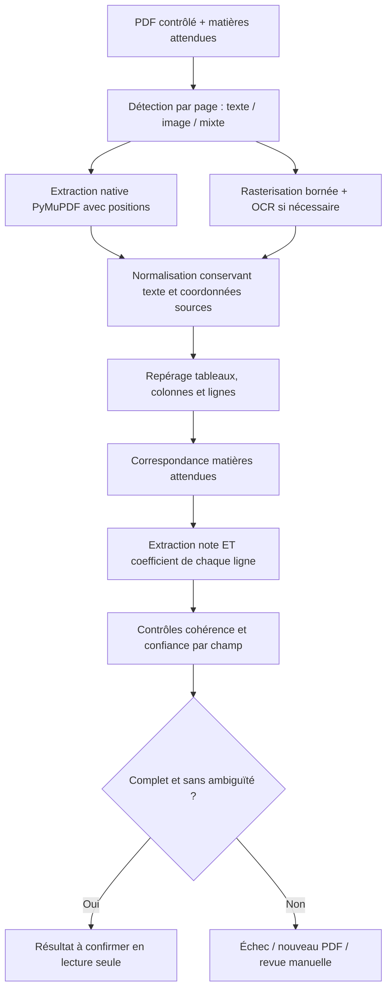

# Pipeline documentaire prévu

Les sections initiales décrivent le contrat cible. La section phase 5 précise le pipeline implémenté et ses limites, avec validation réelle encore en cours.

## Entrée et précondition
Go autorise le dossier, contrôle le PDF et résout d’abord la matrice **campagne/version + diplôme/série + filière**. Le job contient les matières attendues, leurs codes et alias versionnés ; aucun coefficient théorique. Grille absente/incomplète : pas de job de classement, erreur métier explicite.
Entrée : job_id, analysis_id, révision dossier, document_id/version/hash, version contrat et grille, liste des matières canoniques, accès temporaire obtenu par canal interne. Pas d’identité candidat inutile.

## Étapes
1. PDF texte, scanné ou mixte évalué **page par page**. Texte natif inutilisable malgré sa présence : fallback OCR ciblé. PDF chiffré, corrompu ou hors limites : motif sûr et action candidat.
2. PyMuPDF pour texte/blocs/positions et rendu. Tester PaddleOCR et Tesseract sur le corpus IFRI ; choix différé. OpenCV uniquement si deskew/débruitage/segmentation améliore réellement les résultats.
3. Normaliser accents, espaces, casse, ponctuation et décimales françaises en conservant brut et correspondance des positions. Éviter de transformer automatiquement `O` en `0` sans contexte numérique fiable.
4. Identifier colonnes (note, coefficient, autres totaux), regroupement des lignes et pages ; ne pas confondre « note × coefficient » et note, ni rang et coefficient.
5. Correspondance exacte/alias puis fuzzy matching explicable. Plusieurs lignes plausibles, alias collisionnels ou deux matières distinctes : ambiguïté conservée, pas de premier résultat silencieux.
6. Extraire pour **chaque matière attendue** libellé, note et coefficient depuis les zones de la ligne. Ne jamais compléter un coefficient absent avec une table, une autre candidature ou une estimation.
7. Contrôler numérique, échelle, coefficient positif, couverture complète, doublons et cohérence des colonnes ; somme > 0. Les bornes admissibles de coefficients ne sont pas des coefficients prédéfinis et restent à déterminer.
8. Confiance par libellé/note/coefficient et synthèse globale ; score OCR brut ≠ probabilité calibrée. Seuils et méthode de calibration issus d’un corpus annoté ; ne pas inventer « 90 % = fiable ».
9. Go valide et persiste le résultat, puis expose les données au candidat ; Python ne calcule pas la moyenne officielle.

## Sortie et preuve
Contrat cible versionné : identifiants entrée, statut COMPLETE/PARTIAL/FAILED, version moteur, matières attendues, extractions, alternatives, erreurs structurées, durées, confiance. Ces statuts techniques sont mappés par Go vers les états produit ; COMPLETE ne vaut pas confirmation.
Chaque extraction : canonical_subject_id, raw_label, grade nullable, coefficient nullable, page, confiance ; preuve par champ : texte brut, page, bbox `[x0,y0,x1,y1]`, méthode et confiance. Convention proposée : pages indexées à partir de 1 ; bbox normalisée 0..1 dans la page affichée après rotation, origine haut-gauche. Conserver dimensions, rotation et transformation depuis coordonnées natives/pixels pour retrouver précisément la zone. Contrat à tester par overlays sur PDF synthétiques.
Résultat immuable, lié au hash PDF, révision dossier, version grille et moteur. Aucune URL signée persistée. Texte brut et crops éventuels privés soumis à la même conservation que le relevé.

## Échecs, reprises et revue humaine
Distinguer erreurs techniques (timeout, worker interrompu, accès temporaire expiré) et erreurs documentaires (matière/coefficient absent, ambiguïté, illisibilité). Reprises techniques bornées sur le même document ; refus candidat = nouveau PDF. Le nombre de dépôts refusés et les tentatives techniques sont des compteurs distincts.
Résultats tardifs ou dupliqués : validation idempotente, jamais activation d’une version périmée. Quarantaine et isolation précèdent toute extraction. Logs sans texte scolaire ni identité.
Après plusieurs échecs : MANUAL_REVIEW selon politique future. L’administrateur pourra comparer chaque champ à sa zone PDF. Toute transcription manuelle éventuelle est une version distincte avec auteur, motif et preuve ; elle ne crée jamais de coefficient métier. Son autorisation et le retour à confirmation candidat doivent être décidés avant implémentation ; pas de contournement automatique du parcours.

## Évaluation avant choix moteur
Corpus autorisé, anonymisé ou synthétique : BAC C/D/E, DT IMI/DWM/EAP, PDFs texte/scannés/mixtes, rotations, faible résolution, virgules décimales, tableaux multipages, libellés proches, doublons, absence de coefficients et fichiers malveillants contrôlés.
Mesurer exactitude note et coefficient par champ, correspondance matière, taux d’extractions complètes sans erreur, faux résultats acceptés, taux de revue manuelle, latence, RAM/CPU. Séparer corpus de réglage et de validation. Revue des licences PyMuPDF et moteurs avant distribution. Aucune promesse de performance avant benchmark.

## Implémentation historique phase 5 — validée sur fixtures synthétiques

Le pipeline hybride de phase 5 a été validé sur fixtures synthétiques uniquement ; ses mesures sont dans OCR_BENCHMARK. Le chemin actif est modifié par la phase 5.1 ci-dessous. Python 3.14 conservé, PyMuPDF 1.28.2 et RapidFuzz 3.14.6 déclarés ; Tesseract système fra+eng dans l’image Docker. Extraction native des mots avec positions, coordonnées transformées selon la rotation de page ; fallback rasterisation grayscale 200 DPI lorsque texte/en-têtes inutilisables. Limites : OCR_MAX_PAGES (10 local), 25 millions de pixels par page, OCR_PAGE_TIMEOUT_SECONDS (30 local) et OCR_ANALYSIS_TIMEOUT_SECONDS (120 local).

Moteur OCR derrière OcrEngine ; Tesseract TSV fournit mots/bbox/confiance. Aucun filtre OpenCV non mesuré. Les lignes sont reconstruites par proximité verticale ; en-têtes Matière/Note/Coef localisent les bandes horizontales. Chaque cellule numérique doit contenir exactement une valeur. Doublons ou valeurs concurrentes → AMBIGUOUS_ROW, jamais choix arbitraire. Matching RapidFuzz limité à expectedSubjects du job, normalisation NFKD/casse/ponctuation ; ambiguïté entre matières si les deux scores atteignent OCR_MIN_CONFIDENCE et leur marge est <0,08. Une matière sous le seuil ne constitue pas un concurrent valide. Pas de table de coefficients ni valeur manquante inventée.

Decimal Python, chaînes numériques au contrat, big.Rat Go pour validation exacte, NUMERIC PostgreSQL. Note 0..20 et coefficient >0 ; comma/dot conservés dans raw et normalisés dans value. Provenance par champ : bbox normalisée 0..1, origine haut-gauche de la page affichée, page à partir de 1, preuves textuelles minimisées. Pas de texte complet stocké ou journalisé.

Confiance heuristique = minimum(score fuzzy, confiance OCR des mots du libellé, confiance des cellules numériques), avec préconditions fortes de colonne/couverture/nombres valides. Native utilise confiance instrumentale 1 pour les tokens, qui n’est pas une probabilité d’exactitude. OCR_MIN_CONFIDENCE centralisé à 0,85 pour les essais synthétiques, sans calibration officielle. Toutes les matières doivent être complètes et suffisamment fiables pour SUCCEEDED ; échecs/LOW_CONFIDENCE ne permettent aucune confirmation.

Redis Streams ifri:ocr:jobs:v1, groupe ifri-ocr-v1, livraison au moins une fois. Analyse QUEUED durable crée l’outbox dans PostgreSQL ; dispatcher Go publie puis marque dispatched_at dans une transaction. XADD avant échec DB peut dupliquer un message, intentionnellement. Claim interne garde une tentative ; callback lié à la tentative et validé avant transaction. Résultat terminal hashé, callback identique idempotent, différent refusé. ACK après accusé Go uniquement ; XAUTOCLAIM reprend les messages abandonnés après cinq minutes. Reprises techniques OCR_ENGINE_ERROR/ANALYSIS_TIMEOUT limitées à trois tentatives ; échecs de lecture/matching ne sont pas retentés. Les états PROCESSING abandonnés sont remis en queue ou FAILED au plafond.

Accès PDF via endpoint Go interne authentifié, lu depuis le port S3 existant : le worker ne possède aucun credential root/S3 ni accès PostgreSQL. SHA-256 du contenu doit correspondre au hash du job. Listener interne 8081 non publié dans Compose, secret aléatoire distinct, jamais frontend/logs. Upload ou choix académique crée/invalide l’analyse dans une transaction DB ; résultat tardif conservé avec statut OBSOLETE, jamais courant.

Confirmation PENDING/CONFIRMED/REJECTED séparée du statut OCR. Refus exige une nouvelle DocumentVersion ; aucun endpoint d’édition des valeurs. verificationReady est calculé côté Go sur analyse/contexte/document courants, confirmation et documents requis. Aucune moyenne ni soumission.

Une validation sur un corpus anonymisé de relevés réels représentant les différents formats BAC/DT est nécessaire avant mise en production.

Le contrat job/callback porte contractVersion=1. ocr_analysis_attempts mémorise chaque callback accepté (tentative, statut rapporté, code sûr, moteur, digest), y compris les erreurs techniques retentées ; un duplicata identique est reconnu sans modification. Le rejet d’une version de PDF bloque également toute tentative de contournement par changement puis retour de filière/qualification : TRANSCRIPT_REPLACEMENT_REQUIRED, nouvelle version obligatoire. Les lignes TSV du moteur sont utilisées lorsqu’elles sont disponibles ; sinon regroupement spatial. Les colonnes après Coef (Points/totaux) délimitent sa bande pour éviter leur confusion.

L’arrêt du worker coupe le sous-processus pendant l’analyse et conserve le message non acquitté pour reprise. Compose donne 35 secondes de grâce, afin de laisser finir les appels internes bornés à 30 secondes. Le heartbeat vérifie Redis et l’API interne (PostgreSQL/Redis/S3), indépendamment du succès d’un PDF.

## Phase 5.1 — chemin scan principal et profils

Extraction native toujours prioritaire quand mots et en-têtes sont suffisants. PDF image-only reconnu page par page : aucune regex sur un texte vide ; rendu RGB borné et pipeline scan dédié. OpenCV headless 4.13.0.92 et NumPy 2.4.6, Python 3.14 conservé et lock officiel généré sur l’hôte.

Configuration scan centralisée dans ScanSettings : OCR_SCAN_DPI=300, OCR_SCAN_RETRY_DPI=350 (plage admise jusqu’à 400), OCR_SCAN_MAX_PASSES=3. Stratégie initiale à mesurer sur l’hôte : CLAHE 300 DPI / PSM 11 pour les ancres et mots ; adaptive threshold 300 DPI / PSM 6, recadré à la section écrite si elle est reconnue ; dernier essai color-channel 350 DPI seulement si nécessaire (PSM 6 pour section recadrée, sinon 11). Deux variantes sont comparées avant acceptation ; désaccord numérique crédible → AMBIGUOUS_ROW. Pas de cinq OCR haute résolution systématiques. Budget page commun à toutes les passes, budget document et limite 25 millions de pixels conservés.

Variants évaluables en calibration synthétique : grayscale, CLAHE local modéré, adaptive Gaussian après blur 3×3, Otsu, canal choisi selon contraste local. Aucun filtre morphologique agressif retenu sans mesure. OpenCV mono-thread. Deskew fondé sur au moins quatre longues lignes quasi parallèles, angle 0,3–5° et dispersion faible ; aucun angle crédible → pas de rotation. Dispersion élevée suggérant une perspective → LOW_CONFIDENCE ; correction perspective complexe non implémentée.

TranscriptLayoutProfile sépare UNKNOWN_GENERIC et BENIN_BAC_GENERAL. Ancres écrites/premier groupe et baccalauréat/général ; section bornée avant oral/sport/totaux du groupe. Profil BAC : rechercher uniquement les matières du tableau « Épreuves écrites du premier groupe ». Oral et lignes Total ne remplacent jamais les valeurs écrites. Une page orale seule ne fournit aucun résultat écrit. **Cette règle de source documentaire pour ce format doit être confirmée avec les règles officielles de sélection IFRI** ; elle n’est pas une règle universelle BAC/DT. Profils DT non inventés ; fallback générique conserve le refus des doublons ambigus.

Colonnes déduites des centres des en-têtes Matière/Note/Coeff/Points/Sur. Une seule valeur par cellule numérique ; aucune note ni coefficient déduit des totaux. Quand Points et Sur sont clairement disponibles, contrôle secondaire Decimal avec précision suffisante : note×coefficient et 20×coefficient, tolérance d’affichage 0,05 ; contradiction → LOW_CONFIDENCE. Aucun calcul de moyenne. Matching RapidFuzz intervient après restriction section/table et contrôle des colonnes ; bruit technique contrôlé pour MATHEMATI0UES et ANGLAlS, jamais correction numérique agressive.

Confiance reste une heuristique, pas une probabilité : fuzzy et confiance mots/cellules, sous conditions de section/headers/colonnes/couverture, contrôle secondaire et accord entre passes. Les coordonnées de crops/deskew sont transformées inversement vers la page PDF affichée : bbox NORMALIZED_TOP_LEFT d’origine conservée, page indexée à partir de 1. evidence JSON porte aussi profile, section, preprocessing, dpi, psm et angle. Callback Go valide cette provenance optionnelle sans accepter des chaînes arbitraires. Pas de nouvelle migration nécessaire.

Calibration privée : commande séparée ocr_private_calibration.py ; oracle.json et Relever.pdf dans private-fixtures ignoré Git et contextes Docker. Entrée via bind mount read-only uniquement pour exécution locale, jamais COPY dans une image. Aucun nom, portrait, texte OCR intégral, hash ou copie du PDF dans rapport/log/fixtures publiques. Fixture absente : NON TESTÉ, suite normale indépendante. Mesures par catégories distinctes dans OCR_BENCHMARK.

Correction issue du premier test privé 5.1 : pour le profil BAC connu, la section est recadrée à partir de ses bornes d’ancres, même si ses en-têtes ne sont pas encore lisibles ; demander des en-têtes fiables avant crop empêchait précisément le passage qui devait les lire. Les glyphes décoratifs dépassant 2,5 fois la hauteur médiane sont retirés des tokens avant la reconstruction des lignes et des ancres, sans supprimer de pixels du document. Seuil numérique/fuzzy final inchangé. Budget total par page maintenu ; diagnostics locaux limités aux scores de libellés/headers, identifiants canoniques et géométrie, aucun OCR intégral. Le lanceur privé force le rebuild du runner de calibration.

### Stratégie BAC général par cellules — correction demandée

La stratégie active pour les scans BAC général remplace les essais OCR globaux par : correction géométrique prudente (contour de page quadrilatéral crédible, puis deskew), binarisation du canal V HSV (= max RGB), ancres du premier groupe écrit et Total écrit, reconstruction morphologique d'une grille de cinq colonnes fixes, OCR PSM7 de chaque cellule agrandie ×3. Whitelist numérique `0123456789,.`. Les en-têtes OCR ne déterminent plus les colonnes. Les tables sans séparateurs horizontaux internes utilisent les bandes de texte numérique pour reconstruire les séparations ; une géométrie ou des cellules incohérentes imposent NEEDS_REVIEW. Les profils génériques conservent leur chemin existant.

La liste fermée documentaire des matières BAC sert au matching ; elle ne remplace pas le snapshot des matières d'admission. Notes et coefficients viennent toujours de leurs propres cellules. Points = note × coefficient et Sur = 20 × coefficient sont vérifiés exactement sur chaque ligne, puis les sommes coefficient/points/Sur sont comparées au Total écrit. La note récapitulative imprimée peut être arrondie ou tronquée au centième : contrôle secondaire avec tolérance `0,01 × coefficient total` ; aucun résultat de moyenne d'admission n'est créé.

Sur demande explicite de l'utilisateur, ces preuves arithmétiques remplacent le seuil Tesseract **uniquement pour ce profil**. Les confiances réelles restent présentes. Go revérifie indépendamment les produits, sommes, ligne sélectionnée et bornes de valeurs avec `big.Rat` avant acceptation d'une extraction à faible confiance. Les lignes incohérentes portent NEEDS_REVIEW dans le diagnostic ; le résultat conserve l'état terminal existant LOW_CONFIDENCE avec failureCode NEEDS_REVIEW, afin de ne pas inventer un circuit administratif de phase 6.

Diagnostic privé : texte brut des cinq cellules du tableau uniquement, valeurs parsées, contrôles par ligne, contrôles des totaux et série. Aucun en-tête d'identité, texte de page complet, hash ou PDF n'est exporté. Calibration via `ocr_private_run.py` ; l'ancien argument `--evaluate` utilise désormais la même stratégie, sans matrice de variantes. Les anciens benchmarks sont historiques et ne valident pas ce nouveau chemin. Test réel et régression Docker restent à mesurer. RapidOCR sera évalué sur les mêmes cellules seulement si la lecture numérique reste insuffisante, après vérification de compatibilité Python 3.14.

### Correction de segmentation des rangées

Dernier run privé Docker : NEEDS_REVIEW, 18,054 s, deux lignes et cellules vides. Correction : les rangées ne dépendent plus des traits horizontaux ; projection de l'encre dans la colonne Matière après filtrage des motifs et bandes trop courtes selon la hauteur des caractères. La grille conserve la détection morphologique des vrais traits verticaux. Nombre plausible : 5 à 12 rangées de données, sinon ROW_SEGMENTATION_FAILED avant OCR. Ce motif est accepté par Go comme résultat LOW_CONFIDENCE terminal, sans retry technique.

Chaque crop a largeur/hauteur en pixels, proportion de pixels noirs, polarité et éventuel motif vide/timeout. La série est lue séparément, sur une petite zone à droite de son ancre en haut à gauche, whitelist ABCDE. Les images privées de debug (section, overlay des colonnes/bandes, crops avant/après agrandissement) sont écrites uniquement lors de la calibration dans un répertoire `/tmp/ifri-ocr-private-debug-*`, monté en écriture ; aucun fichier privé ne rejoint le dépôt ni le build Docker.

Vérification locale de segmentation sur une zone de tableau sélectionnée pour le diagnostic, sans Tesseract : 8 rangées de données, 40 crops non vides, dimensions minimales 196 × 42 pixels, proportion noire 0,0197 à 0,799. Ces mesures ne prouvent pas encore la localisation automatique ni la lisibilité OCR ; le nouveau run Docker reste nécessaire.

### Bordures, colonnes et budget de calibration

La sélection des colonnes est ancrée aux extrémités du premier trait horizontal long du tableau. Six axes sont recherchés à l'intérieur de cette bordure, près des ratios du profil stable : 0 / 0,535 / 0,645 / 0,755 / 0,89 / 1. Un axe absent ou décalé déclenche le fallback de ratios, jamais une translation silencieuse des cinq colonnes. Matière est nettement plus large ; Points est légèrement plus large que Note/Coeff/Sur. Un tableau sans bordure crédible renvoie COLUMN_SEGMENTATION_FAILED.

Otsu est calculé sur le canal V de chaque crop, avec marge intérieure de 8 pixels sur X et 5 sur Y pour exclure les traits. Les temps par cellule sont consignés. La boucle s'arrête dès reconnaissance du libellé Total ; aucune rangée orale n'est ajoutée. La calibration privée seule dispose de 120 secondes par page ; le budget production reste inchangé. Le prochain benchmark devra comparer ce coût à cinq appels Tesseract par bandes de colonnes PSM6 (numériques avec whitelist), sur les mêmes limites et contrôles, avant tout changement de stratégie production.

Règle d'acceptation mise à jour sur instruction utilisateur : Note et Coeff sont obligatoires ; Sur doit être lisible et égal à 20 × Coeff. Points peut être illisible (diagnostic `null` pour ce contrôle), mais une valeur lisible contradictoire bloque la ligne. Go applique la même règle, conserve Points manquant sans fabriquer de valeur extraite et vérifie les sommes contre les totaux lisibles. Les produits calculés sont exclusivement des contrôles documentaires.

Le run privé précédent reste en échec : 31,193 s, colonnes décalées, budget épuisé. La vérification locale sur la zone de tableau diagnostique retrouve 8 rangées et des largeurs relatives 53/11/11/13/11 %, sans succès OCR déclaré. Le nouveau run automatique Docker reste à effectuer.

### Règle d'acceptation corrigée — prioritaire sur la règle précédente

Sur = 20 × Coeff valide uniquement le coefficient. Une note exige Points = Note × Coeff sur sa ligne, OU les deux sommes exactes Σ Note×Coeff = Total Points et Σ Coeff = Total Coeff. Points illisible ne valide donc plus une note sans totaux. Points lisible contradictoire reste bloquant. Les statuts `coefficientStatus` et `gradeStatus` sont séparés ; validation par ligne ou par totaux explicitée. Go vérifie la preuve décimale indépendamment et exige des totaux Points lisibles pour l'acceptation du dossier. Coeff entier 1..6 ; Sur multiple de 20 cohérent ; Note 0..20. Aucun seuil de confiance ne supplée un contrôle arithmétique manquant.

La limite physique de l'en-tête est exclue avant la projection des rangées, avec marge intérieure de 5 px sur X / 4 px sur Y. Le traitement effectif de chaque cellule est loggé : HSV_V_CELL_OTSU ; pour Points trop noir (>45 %), RED_CELL_CLAHE_OTSU. Cette décision utilise la densité du crop, pas ses valeurs attendues. Le TSV d'un seul appel fournit texte et confiance : seuls les mots level=5, confidences négatives ignorées et comptées, confiance moyenne des mots restants, véritables zéros conservés.

Dernier scan privé Docker : 36,864 s, NEEDS_REVIEW, aucune extraction complète acceptée, Total et série encore illisibles. Il ne valide pas la nouvelle correction. Les contrôles locaux et le run privé suivant restent distincts.

### Borne du premier tableau écrit — non-régression

Le run privé précédent (12,611 s, ROW_SEGMENTATION_FAILED) incluait le tableau EPS dans les bandes. Les bandes sont désormais regroupées par écarts : un saut supérieur à 2,5 × l'écart médian ouvre un autre tableau ; seul le premier tableau après le titre écrit est retenu. L'écart en-tête/première matière n'est pas une coupure de tableau. Le séparateur d'en-tête est recherché exclusivement entre la bande d'en-tête et la première bande de données. L'OCR s'arrête au Total écrit inclus, sans nombre de matières fixé selon une série.

Tests : bornes transmises (en-tête + 7 matières + Total + EPS), exemple plus court à nombre variable, et image synthétique à deux tableaux largement séparés. Suite Python : 66 PASS. Les règles de preuve de note par Points/totaux, contraintes de coefficient, Otsu par cellule avec fallback rouge pour Points, et confiance du même TSV restent inchangées et couvertes. Aucun nouveau résultat OCR privé n'est déclaré avant relance Docker.

### Correction documentaire : notes dérivées exclusivement après trois totaux

Instruction utilisateur prioritaire : quand Σ Coeff, Σ Points et Σ Sur lus correspondent tous aux cellules Total, la valeur retenue de chaque note est Points ÷ Coeff, avec `gradeStatus=VALIDATED_BY_TOTALS` et `gradeSource=POINTS_TOTALS`. La lecture brute/directe et sa divergence restent conservées. Coeff n'est jamais dérivé. Une somme fausse ou incomplète garde toutes les lignes en NEEDS_REVIEW. Les décimales non terminantes ne sont ni arrondies ni inventées. Go autorise une divergence note brute/valeur retenue uniquement pour ce mode avec preuve complète indépendante en rationnels exacts et coordonnées Points/Sur ; les autres extractions gardent l'égalité lecture brute/valeur. Aucun calcul de moyenne d'admission n'est introduit.

Parseur : virgule décimale et séparateur final isolé acceptés (`18.`, `80 .`), sans assembler des chiffres séparés. Le contrôle Sur/Coeff ne dépend plus de la lisibilité de Note. Les noyaux morphologiques longs suppriment les traits sur chaque cellule avant agrandissement ; les crops de données ont une marge symétrique autour de leur propre bande, y compris Anglais, sans remonter à l'en-tête. Seuils de confiance inchangés.

Dernier run privé : 40,398 s, NEEDS_REVIEW, 8 rangées correctement isolées ; les notes et totaux restent insuffisants. La nouvelle correction attend son run OCR réel. Validation locale avant relance : 74 tests Python et Go tests PASS ; aucune précision réelle déclarée acquise.
